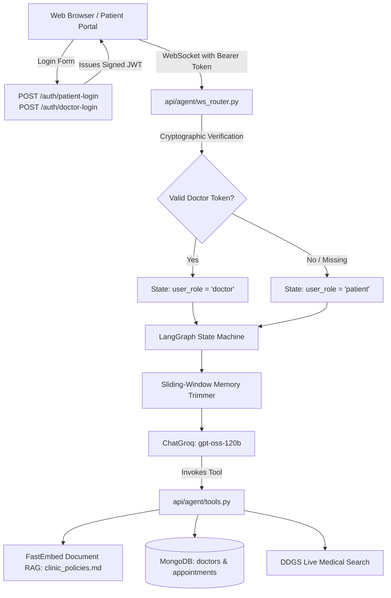

# 🏥 MediCare AI — Smart Healthcare & Clinic Operations Copilot

[](https://fastapi.tiangolo.com)
[](https://langchain-ai.github.io/langgraph/)
[](https://groq.com)
[](https://github.com/qdrant/fastembed)
[](https://www.mongodb.com/)
[](https://opensource.org/licenses/MIT)

**MediCare AI** is an enterprise-grade clinical operations assistant built with **FastAPI**, **LangGraph**, **Groq LLMs**, **FastEmbed semantic RAG**, and **MongoDB**. It serves as an intelligent copilot for outpatient clinics, medical centers, and private practices — enabling patients to find matching specialists, schedule consultations, and verify medical preparation rules, while empowering attending physicians with secure schedule management and cryptographic role-based access control (RBAC).

---

## 🌟 Core Capabilities & Features

### 1. 🔒 Enterprise RBAC & Cryptographic Authentication
- **Defense-in-Depth Security**: Eliminates client-side role spoofing vulnerabilities.
- **Cryptographic JWT Badges**: Attending physicians authenticate using a clinic security PIN to obtain cryptographically signed tokens containing role and identity claims.
- **Server-Enforced Role Gates**: The WebSocket server and LangGraph state machine permanently enforce patient mode unless a valid physician token is verified.
- **HIPAA-Compliant Privacy Protection**: The agent strictly refrains from disclosing doctor schedules or patient consultations to unauthorized patient users.

### 2. 🧠 LangGraph State Machine with Sliding-Window Memory
- **Persistent MongoDB Sessions**: Every conversation thread is checkpointed to MongoDB (`MongoDBSaver`), surviving server restarts and network interruptions.
- **Sliding-Window Memory Trimming**: Keeps the dynamic SystemMessage + the last 10 turns, preventing `413 rate_limit_exceeded` token overflow errors permanently.
- **Tool Calling Orchestration**: Binds specialized clinical tools to Groq's high-performance `openai/gpt-oss-120b` model.

### 3. 📚 Document-Grounded Semantic RAG (FastEmbed)
- **Universal Plain Document Chunking**: Reads raw policies from `clinic_policies.md` using `RecursiveCharacterTextSplitter` (no custom formatting or `##` markdown required).
- **Zero Hallucination on Clinical Advice**: FastEmbed (`BAAI/bge-small-en-v1.5`) runs locally on CPU (~20ms) to verify fasting requirements, diagnostic prep rules, insurance networks, and cancellation fees.

### 4. 📅 Conflict-Free Appointment Scheduling
- **Doctor Roster Search**: Hybrid search matching patient symptoms (e.g., chest pain, skin rash, joint injuries) to clinical specialties (Cardiology, Dermatology, Orthopedics, Pediatrics, Neurology).
- **Double-Booking Prevention**: Automatically validates doctor availability slots before issuing confirmed booking reference numbers (`APT-XXXXX`).
- **Guarded Cancellation**: Patients can cancel appointments via reference code; surgical procedures trigger doctor review.

### 5. ⚡ Real-Time Fault-Tolerant WebSockets
- **Two-Tier Error Boundary**: Decouples turn-level tool exceptions from network lifecycle. The socket remains connected even when user input is invalid or tools fail.
- **Streaming Tokens & Status Badges**: Emits real-time progress events (`tool_start`, `chunk`, `status`, `done`).

---

## 🏛️ System Architecture



---

## 📂 Project Structure

```text
medical_care_ai/
├── pyproject.toml              # UV package manager definition with 15 dependencies
├── uv.lock                     # Deterministic dependency lockfile
├── .env.example                # Template for environment variables
├── clinic_policies.md          # Real-world clinic guidelines & preparation rules
│
├── core/
│   ├── config.py               # Pydantic Settings reading .env
│   ├── database.py             # Motor async MongoDB engine (doctors, appointments, patients)
│   └── security.py             # Argon2 password hashing & PyJWT token generator/decoder
│
├── api/
│   ├── auth/
│   │   └── router.py           # Patient & Doctor login endpoints issuing verified JWTs
│   │
│   ├── clinic/
│   │   ├── schema.py           # Pydantic models for Doctors and Appointments
│   │   └── service.py          # Business logic: Doctor seeding, search, booking, cancellation
│   │
│   └── agent/
│       ├── rag.py              # FastEmbed universal document RAG engine
│       ├── tools.py            # LangChain tools: doctor_search, book, cancel, view_schedule
│       ├── graph.py            # LangGraph StateGraph + MongoDBSaver + sliding memory
│       └── ws_router.py        # Fault-tolerant bi-directional streaming WebSocket
│
├── static/
│   └── clinic_chat.html        # Interactive portal with Login Screen, live badges & role toggles
│
└── main.py                     # FastAPI entry point, CORS, static mounting & lifespan startup
```

---

## 🚀 Quick Start Guide

### Prerequisites
- **Python 3.12+**
- **MongoDB** running locally on port `27017` (or MongoDB Atlas URI)
- **Groq API Key** ([console.groq.com](https://console.groq.com))
- **uv** Package Manager:
  ```powershell
  pip install uv
  ```

### 1. Clone the Repository
```bash
git clone https://github.com/maazkhanmaaz366-arch/medicare_AI.git
cd medicare_AI
```

### 2. Configure Environment Variables
Copy `.env.example` to `.env` and insert your credentials:
```bash
cp .env.example .env
```

Edit `.env`:
```env
PROJECT_NAME="MediCare AI - Clinic Operations Copilot"
VERSION="1.0.0"
MONGO_URL="mongodb://localhost:27017"
DATABASE_NAME="medicare_db"
GROQ_API_KEY="gsk_your_groq_api_key_here"
SECRET_KEY="super_secure_medicare_secret_key_32bytes_long"
ALGORITHM="HS256"
ACCESS_TOKEN_EXPIRE_MINUTES=60
```

### 3. Install Dependencies
```bash
uv sync
```

### 4. Run the Server
```bash
uv run uvicorn main:app --reload --port 8000
```

On startup:
- Top specialist doctors (Cardiologist, Dermatologist, Orthopedic Surgeon, Pediatrician, Neurologist) are auto-seeded into MongoDB.
- `clinic_policies.md` is vectorized in-memory in ~20ms.

---

## 💻 Web Interface & Testing Scenarios

Open your browser at:
👉 **[http://localhost:8000/static/clinic_chat.html](http://localhost:8000/static/clinic_chat.html)**

### 🧑 Scenario A: Patient Portal
1. Enter your name (e.g., `Hamza Khan`) and phone (`+1-555-0199`), then click **Check In & Enter Chat**.
2. **Find Specialists**:
   > *"I have severe chest pain and palpitations on weekends. Who can I see?"*
   - The agent calls `search_doctors_tool`, finds **Dr. Emily Watson (Cardiology)**, and outputs fees and hours.
3. **Clinical Prep Guidelines (RAG)**:
   > *"Can I drink coffee or eat breakfast before my morning fasting blood sugar test?"*
   - The agent retrieves the rule from `clinic_policies.md` and explains that coffee and food are strictly prohibited.
4. **Book an Appointment**:
   > *"Book an appointment with Dr. Emily Watson on 2026-11-25 at 10:00 AM for routine heart checkup."*
   - Saves into MongoDB and returns reference `#APT-XXXXX`.
5. **Unauthorized Schedule Probe**:
   > *"Show me Dr. Watson's full patient list."*
   - The agent **refuses access**, protecting medical privacy under HIPAA.

---

### 🩺 Scenario B: Physician Portal
1. Click **🚪 Logout**, switch to the **Physician Portal** tab.
2. Select **Dr. Emily Watson** and enter Clinic Security PIN: `doc123`.
3. Click **Verify Credentials**. A cryptographic Physician JWT is signed and issued.
4. **View Doctor Schedule**:
   > *"What appointments do I have booked for this week?"*
   - The agent recognizes your physician badge, invokes `view_doctor_schedule_tool`, and lists your patients' consultations.

---

## 🛠️ Tech Stack

| Technology | Purpose |
| :--- | :--- |
| **FastAPI** | High-performance async REST & WebSocket web framework |
| **LangGraph** | Multi-step agentic state machine with persistent checkpointers |
| **Groq (gpt-oss-120b)** | Ultra-fast LLM inference (~1.3s response times) |
| **FastEmbed** | Local CPU vector embeddings (`BAAI/bge-small-en-v1.5`) |
| **Motor & PyMongo** | Non-blocking async MongoDB driver for clinic domain entities |
| **PyJWT & Argon2** | Cryptographic token signing and password hashing |
| **DDGS** | Real-time medical web search |
| **UV** | Ultra-fast modern Python project and dependency manager |

---

## 📄 License
This project is licensed under the MIT License.
